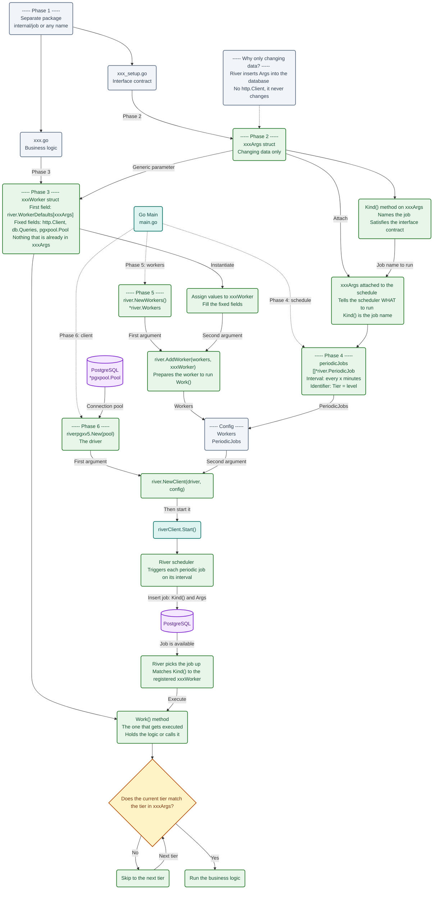

## Where I Noticed the Gap

* I noticed it the moment I thought that there's something wrong in my idea, when I finished with the handlers, I though to myself "Wait... I need to run each every 'x' minutes, but I am doing something wrong, I am currently exposing the functions as APIs". This was the smoking gun.

## The Problem

* Since I wanted to run the function every 'x' minutes in the background, I was forced to think of something to do, since exposing the functions as APIs is not what we needed, because we don't need somebody to write `curl https/[api.example.com/youtube/kimishinu](https://api.example.com/youtube/kimishinu)` or something like this to make it work, the original idea is sending it to azure and make the docker continiously running, then apply updates via CI/CD, which don't include any "User will send request".

## Underlying Concept / How It Works

* At start, I used to get tripped around plently of concepts, because `river`, sadly, got too many for an engineer's comfort. Let's divide everything in phases, what we should do and what each expects:
* **Phase 1** -> It's suggested to create for it a folder apart with a different package, in most cases the path should simply be `internal/job` or whatever you wanna name it, then inside it you can create a file as `youtube_poll.go`, but I usually separate the interface contract part from the logic part by creating a `youtube_poll_setup.go` file too.
* **Phase 2** -> Inside `youtube_poll_setup.go` we create a structe (usualy "xxxArgs") and inside it we store changing data - why? Because `river` usually inserts it in the database, and we don't want it to insert stuff as `http.Client` would cause problems, and we also know that the http.Client never changes, so it's pretty useless storing it too. Then after we created the stucture, we create a function (which bears as method the "xxxArgs") - think of `Kind()` as naming the job, per se it satisfies the interface contract.
* **Phase 3** -> Inside `youtube_setup.go` we create a structure (usualy "xxxWorker") in which the first field will be `river.WorkerDefaults[xxxArgs]` and the rest will be fields that don't change (as the `http.Client`, `db.Queries`, `pgxpool.Pool`, etc... - excluding the fields we already gave to "xxxArgs"). Think of it as the idiomatic field we put inside `youtube/youtube.go` since it will act as the method of the business logic function - just like an idiomatic handler we used to do. Then we create a function with the name Work() - whose role is simply that it will be the one getting executed, so here should be the logic, or the one calling the main logic.
* **Phase 4** -> Once everything is done, you need to wire it up inside `main.go`. Inside the main we can start in multiple ways, but I usually start with the periodicJobs (The timer, as run every 'x' minutes), what it does? We simply declare `[]*river.PeriodicJob` eldritch? - well, this is what the river client expects, so can't blame. Inside it we simply add the time and the identifier (in our case, it's the `Tier: "<level>"` but noticed that we add the "xxxArgs"? - we do it to make the scheduler understand what exactly to schedule, because it's not like it can guess by saying "uhh... I mean, I have the instruction 'Run every 10 minutes if tier is 'fast'... but what exactly to run??" - since we attach to it the "xxxArgs", it has full context that it gotta run the job that `Kind()` declares - as example, if we give it `YoutubePollArgs` it will understand that it gotta run the job `"youtube_poll"`, which guess what, it has a connection with the `Work()` since it assigns the time based on `Tier` we clearly state in the `Work()` "If current tier is not the tier provided inside the structure (as `Channel`) - then skip it to the next tier to see if it matches".
* **Phase 5** -> Then, after scheduling, we simply assign the workers, it's pretty simple, think of this as "assigning the values to the "xxxWorker" so we can use it - just think of it as the "New()" of river, in which when we insert the workers, and the workers under the hood prepare to run the `Work()` function. The workers are explicit, they expect two things, a `*river.Workers` (which you get by running `river.NewWorkers()`) and the "xxxWorker".
* **Phase 6** -> In finale, just create a `river.Client`, usually via `river.NewClient()` as first argument it expects the driver, which we can create via our pool of connection (`*pgxpool.Pool`) - so just throw at it `riverpgxv5.New(pool)` so it chokes, in finale give it the configuration with the workers and schedules - then start it.

## Workflow / Lifecycle (Diagram)

* I will explain what each file does, then we go with what happens fully.


## Example Code and Explanation
* I will use as example the discord job first
* **`discord_send_setup.go`:**
```go
package job

type DiscordSendArgs struct {
	Source     string
	Identifier string
	Trace      string
}

func (DiscordSendArgs) Kind() string {
	return "discord_send"
}

```
* * * **Explanation** -> This is the `xxxArgs` thingy, it's only job is to hold changeable datas (since River is going to reuse the from the database, and hold stored, while the rest inside `xxxWorker` is given by main and obviously not changable). Here `Kind()` does the heavy-lifting, usually names the job and satisfy the interface contract.
* **`discord_send.go`:**
```go
package job

import (
	"context"
	"kimishinu/internal/discord"
	"net/http"

	"github.com/riverqueue/river"
)

type DiscordSendWorker struct {
	river.WorkerDefaults[DiscordSendArgs]
	WebhookURL string
	HttpClient http.Client
}

func (w *DiscordSendWorker) Work(ctx context.Context, job *river.Job[DiscordSendArgs]) error {
	identifier := job.Args.Identifier
	source := job.Args.Source
	trace := job.Args.Trace

	bodyBytes, err := discord.ConvertToDiscordFormat(source, identifier)
	if err != nil {
		return err
	}

	d := discord.New(w.HttpClient, w.WebhookURL)

	err = d.Send(trace, bodyBytes)
	if err != nil {
		return err
	}

	return nil
}
```
* * * **Explanation** -> We start woth the `xxxWroker` structure, which will hold inside all the immutable datas. But as first field, it MUST have `river.WorkerDefaults[xxxArgs]` - since this is the part where we use `Kind()`. After this, we create a function called `Work()` - inside it we simply write what we would like it to run, as example, this will simply send the given data to discord. Also, see that we don't add the DiscordSendArgs here, because it will already run whenever other jobs as `youtube_poll` runs, and it will create a job with the given `DiscordSendArgs` and River will pick it up and run it. Because when we do `river.InsertTx` it will insert the given data into the database, in our case, it will insert the `DiscordSendArgs` into the database, and also `available` to be picked up by River - and since river is always running, it will pick it up and run the `Work()` function (since the job names points to it).
* **`main.go`**:
```go
// All the variable assignments are omitted for brevity, but they are the same as the ones in the previous example
periodicJobs := []*river.PeriodicJob{
    river.NewPeriodicJob(
        river.PeriodicInterval(10*time.Minute),
        func() (river.JobArgs, *river.InsertOpts) {
            return job.YoutubePollArgs{Tier: "fast"}, nil
        },
        &river.PeriodicJobOpts{RunOnStart: true},
    ),
    river.NewPeriodicJob(
        river.PeriodicInterval(1*time.Hour),
        func() (river.JobArgs, *river.InsertOpts) {
            return job.YoutubePollArgs{Tier: "slow"}, nil
        },
        &river.PeriodicJobOpts{RunOnStart: true},
    ),
}
workers := river.NewWorkers()
// Think of this process as actually giving the values to "Worker" - so it can run normally
discordWorker := &job.DiscordSendWorker{
    WebhookURL: webhookURL,
    HttpClient: httpClient,
}
youtubeWorker := &job.YoutubePollWorker{
    ApiKey:     youtubeAPI,
    WebhookURL: webhookURL,
    Pool:       pool,
    Queries:    queries,
    HttpClient: httpClient,
    // To avoid the chicken-and-egg problem, we simply let it "nil" for now, and we will add it later
}

river.AddWorker(workers, discordWorker)
river.AddWorker(workers, youtubeWorker)

riverClient, err := river.NewClient(riverpgxv5.New(pool), &river.Config{
    Workers:      workers,
    PeriodicJobs: periodicJobs,
})
if err != nil {
    panic(err)
}

// we added it a value via pointer
youtubeWorker.RiverClient = riverClient

err = riverClient.Start(context.Background())
if err != nil {
    panic(err)
}
defer func() {
    err := riverClient.Stop(context.Background())
    if err != nil {
        panic(err)
    }
}()
```
* * * **Explanation** -> First, the `periodicJobs` tell River what to run and how often to run it. In this example, River runs `YoutubePoll` every 10 minutes with `YoutubePollArgs{Tier: "fast"}` (simply will run 6 times with the `Tier: "fast"` as argument), and every hour with `YoutubePollArgs{Tier: "slow"}`. Both schedules also use `RunOnStart: true`, so each one runs once as soon as River starts. Since one hour contains six 10-minute intervals, the fast schedule runs six times for every one run of the slow schedule.

When the `YoutubePollWorker` receives one of these jobs, it loops through all the channels. Its tier check is effectively:

```go
if ch.Tier != job.Args.Tier {
    continue
}
```
This means that a fast job processes only fast channels, while a slow job processes only slow channels. When a channel has a different tier, `continue` skips that channel and moves to the next one. It does not cancel the River job, remove the channel, or send the channel to another queue. The channel is simply checked again the next time a job runs. After setting up the schedules, we create the workers, give them their fixed values such as `http.Client` and `db.Queries`, register them with River, create the `river.Client`, and start it. We do not schedule `discord_send` here because `youtube_poll` creates that job when it finds a new video; River then provides reliability by retrying the Discord job if sending fails.

## What I Still Don't Understand
* I pretty much understand everything, but I am not able to explain to miself the whole process or how exactly it works under the hood, but I know that it works, and I know that it is reliable, so I don't care about the inner workings of it. I just care about the interface and how to use it. Since I need to ship the code, not to become a "master-of-river" or anything like that.
