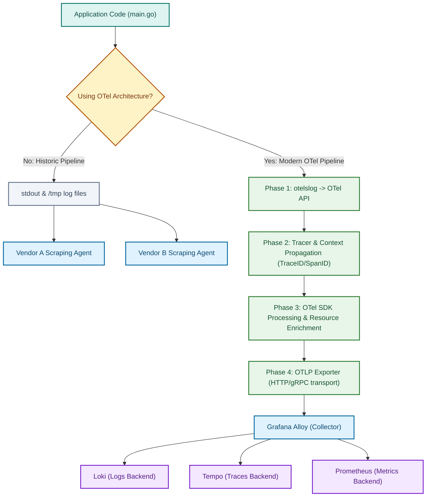

## The Problem

* The problem was evident: to use multiple vendors, you'd need multiple logs writing to each. Historically, sending telemetry data (metrics, logs, and traces) to multiple vendors required managing multiple agents and formats. For example, if you output JSON logs, metrics, and trace data all to `stdout`, you create a chaotic pipeline. Every vendor expects data in its own specific format, forcing you to run various agents to scrape `stdout` or parse temporary files (like writing to `/tmp/log/mimi.log` just so Grafana Alloy can read it). Instead of forcing your application to format data specifically for a vendor's agent, we use OTel. OTel provides standard SDKs to structure our data, injects useful context (like correlating traces with logs), and transmits it via a unified protocol (OTLP).
* **Without OTel** -> Suppose your company wants to migrate its metrics backend from Prometheus to VictoriaMetrics. Historically, your application code was instrumented specifically for Prometheus. To migrate, you would have to rewrite your code's instrumentation and deploy new scraping agents.
* **With OTel** -> Because your application emits standard OTel data, the backend vendor doesn't matter. If you migrate from Prometheus to VictoriaMetrics, your application code remains completely untouched. You simply update the exporter configuration in your collector (like Grafana Alloy), and the pipeline seamlessly routes the data to the new destination.

## Underlying Concept / How It Works

* I will separate the processes by phases:
* **Phase 1** -> Instead of forcing our logging to get sent via `stdout`, we will change the logging direction entirely; we will send them to the OTel API, which from now on will consume our logging. We do it simply by changing `slog` to `otelslog` (a built-in extension of the slog environment). Then we add the logger given by `otelslog` as our "DefaultLogger". During this phase, you'll have no way to see your logging in the terminal, since `otelslog.NewLogger` creates a logger that is automatically preset to output to the OTel API—no `stdout`.
* **Phase 2** -> After this, we simply use the built-in tracer provided by `otel`, which is `otel.Tracer`. After getting it, we call `tracer.Start()`, which expects a `context.Context` as its first argument. It does this because it will attach the newly generated `trace_id` and `span_id` to the context and return a new context containing both. This is why we need to use `slog.InfoContext` instead of `slog.Info` and so on, because `InfoContext` will expand the `trace_id` and `span_id` that we passed through the context.
* **Phase 3** -> Since we got the logging well-structured and sitting comfortably at the OTel API, we need a way to process our logs before they leave the API, so we let the OTel SDK handle this—it will enrich our logs with the `resource` (identifying the service name, host, or environment) and more.
* **Phase 4** -> Now, we need a way to send that data to a Collector (in our case, Alloy). It's not like we will tell Alloy "Hey, watch the OTel API and fetch data randomly"—that would be catastrophic! What if some data is just sent, some is getting processed, and some is finished? We would get a mess. So we make OTel act as a transport—we let OTLP handle everything. Its job is simple: we specify where to export the data and which protocol to use (be it HTTP or gRPC). In the end, it will take the processed data and send it to our Collector.

## Workflow / Lifecycle (Diagram)



## Example Code and Explanation

* I will show how we change it inside the logger and inside main, and what it means.
* **`logger.go`:**

```go
package lib

import (
    "log/slog"

    "go.opentelemetry.io/contrib/bridges/otelslog"
)

func NewLogger(serviceName string) *slog.Logger {
    logger := otelslog.NewLogger(serviceName)

    slog.SetDefault(logger)

    return logger
}

```

* **Explanation** -> Instead of using `slog.NewJSONHandler` and assigning it to `stdout`, we simply use `otelslog.NewLogger`. Here you don't need to specify the log level, since OTel takes all levels, nor do you need to specify where the logger should send logs, since they automatically go to the OTel API. Why? Because from now on, we just need to process the data inside and hand it to OTLP to export it to whichever vendor we want.
* **`main.go`:**

```go
var tracer = otel.Tracer("main")

// All the logic remains the same
ctx := context.Background()
newCtx, span := tracer.Start(ctx, "main_kimishinu")
defer span.End()

```

* **Explanation** -> We define a package-level `Tracer`. When we call `tracer.Start()`, it performs several actions under the hood, most notably extracting the incoming context, embedding or generating the `trace_id` and `span_id`, and returning a new context containing both. While you aren't forced to pass this context everywhere, doing so is essential for distributed tracing, which is why you pass it down through your function calls. To bridge this data to your logs, you use `slog.InfoContext()` instead of `slog.Info()` so it automatically unwraps the `trace_id` and `span_id` into the log output. However, OpenTelemetry doesn't build the trace tree automatically—you must explicitly create parent and child spans to form the execution hierarchy. Let's break down what `ctx` and `span` do:
* **span** -> Think of it as a recorder and timer. It measures how long a specific block of code takes to execute, records errors, and tracks success/failure statuses.
* **ctx** -> Think of standard Go context, but supercharged. When passed into `tracer.Start`, it automatically links the new span as a child of whatever span is currently active in that context. Here is an example:

```go
ctx := context.Background()
logger := lib.LoggerNew("kimishinu_poll")
// We just created the parent span, everything starts from here
rootCtx, parentSpan := tracer.Start(ctx, "main.start")
defer parentSpan.End()

// This is a child span, it gets nested under "parentSpan" (because we use its context)
otelCtx, otelSpan := tracer.Start(rootCtx, "main.otel.setup")
defer otelSpan.End()
loggerProv, err := observability.LoggerSetup(otelCtx)
if err != nil {
    otelSpan.RecordError(err)
    otelSpan.SetStatus(codes.Error, "failed to create an extractor")
    err = failure.Wrap("main.otel.extractor.create", err)
    // Fallback only: the structured OTel log is the primary error path.
    fmt.Fprintf(os.Stderr, "main: %v\n", err)
    errlog.Internal(*logger, "otel_extractor_create", failure.InternalGeneralError, err)
    return 1
}
defer func() {
    shutdownCtx, cancel := context.WithTimeout(context.Background(), 5*time.Second)
    defer cancel()
    err := loggerProv.Shutdown(shutdownCtx)
    if err != nil {
        otelSpan.RecordError(err)
        otelSpan.SetStatus(codes.Error, "failed to close the provider")
        err = failure.Wrap("main.otel.provider.close", err)
        errlog.Internal(*logger, "otel_provider_close", failure.InternalGeneralError, err)
    }
}()

otel.SetLoggerProvider(loggerProv)

// This is another child span that gets nested under "parentSpan" (because we use "rootCtx" as context)
_, envSpan := tracer.Start(rootCtx, "main.environment.variable.fetch")
defer envSpan.End()

```

* See? We created a parent span and two child spans. If an error occurs due to a missing environment variable, the resulting trace tree looks like this:

```plaintext
main.start
|_____main.otel.setup
|_____main.environment.variable.fetch <- marked red because it failed

```

* So far we learned how to polish and create useful stuff, but we need different stuff too, like how to run it, which is much more precious than just "how to print pretty things" and structure (joking). Let's start simple: **YOU DON'T NEED TO MEMORIZE THE COMMANDS OR ANYTHING AT ALL**. The important part is actually understanding what it does and how it works, not "I memorized every single command without documentation in front of my eyes"—that's a bad habit, because it's not like you're working every second with OTel; you'll probably work with it weekly or monthly, which will clearly make you forget things. So please, the only thing you gotta really memorize here is the link to the [OTel documentation](https://opentelemetry.io/docs/languages/go/instrumentation/#direct-to-collector). Let me show you the wiring-up part, which is much more fun:

```go
package observability

import (
    "context"

    "go.opentelemetry.io/otel/exporters/otlp/otlplog/otlploghttp"
    "go.opentelemetry.io/otel/sdk/log"
)

func LoggerSetup(ctx context.Context) (*log.LoggerProvider, error) {
    exporter, err := otlploghttp.New(ctx, otlploghttp.WithEndpoint("alloy:4318"), otlploghttp.WithInsecure())
	if err != nil {
		return nil, err
	}
	procesor := log.NewBatchProcessor(exporter)
	return log.NewLoggerProvider(log.WithProcessor(procesor)), nil
}

```

* Now, let me explain what happens here. First, we create an exporter using `otlploghttp.New()`. The exporter needs an endpoint, which this example provides directly as `alloy:4318` through `WithEndpoint(...)`. `OTEL_EXPORTER_OTLP_ENDPOINT` is an alternative way to configure that endpoint, not a requirement for this setup. From there, OTel acts as a pipeline to our collector (the one receiving logs from the OTel API). After this, we use `log.NewBatchProcessor` to batch the logs before they are exported. The logs collect inside the OTel API, so the batch processor periodically sends them to the exporter. This avoids opening a new connection for every log line and reduces latency. Finally, `log.NewLoggerProvider` hands the logging over to the batch processor and manages the log metadata. It is also strongly recommended to set the service name with the `OTEL_SERVICE_NAME` environment variable; otherwise, it may default to a confusing name.

## What I Still Don't Understand

//