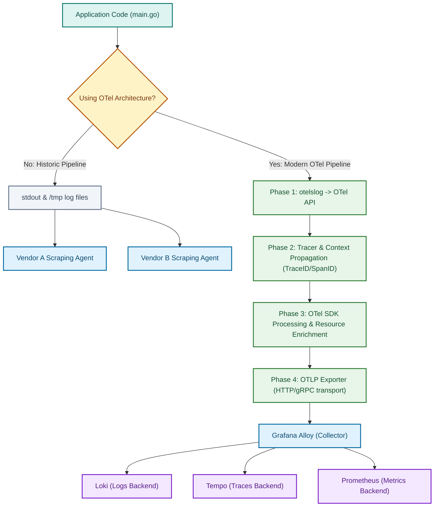

## The Problem
- The problem was evident, to use multiple vendors, you'd need multiple logs writing to each. Historically, sending telemetry data (metrics, logs, and traces) to multiple vendors required managing multiple agents and formats. For example, if you output JSON logs, metrics, and trace data all to `stdout`, you create a chaotic pipeline. Every vendor expects data in its own specific format, forcing you to run various agents to scrape `stdout` or parse temporary files (like writing to /tmp/log/mimi.log just so Grafana Alloy can read it). Istead of forcing your application to format data specifically for a vendor's agent, we use OTel. OTel provides standard SDKs to structure our data, injects useful context (like correlating traces with logs), and transmits it via a unified protocol (OTLP).
- **Without Otel** -> Suppose your company wants to migrate its metrics backend from Prometheus to VictoriaMetrics. Historically, your application code was instrumented specifically for Prometheus. To migrate, you would have to rewrite your code's instrumentation and deploy new scraping agents.
- **With Otel** -> Because your application emits standard OTel data, the backend vendor doesn't matter. If you migrate from Prometheus to VictoriaMetrics, your application code remains completely untouched. You simply update the exporter configuration in your collector (like Grafana Alloy), and the pipeline seamlessly routes the data to the new destination.

## Underlying Concept / How It Works
* I will separate the processes by phases:
* **Phase 1** -> Instead of forcing our logging to get sent via `stdout`, we will change the logging direction entirely, we will send them to the OTel API, which from now on, will consume our logging. We do it simply by changing `slog` to `otelslog` (a built-in extension of the slog environment). Then we add the logger given by `otelslog` as out "DefaultLogger" - during this phase, you'll have no way to see your logging, since `otelslog.NewLogger` creates a logger that automatically is preset to output to the OTel API - no `stdout`.
* **Phase 2** -> After this, we simply use the built-in tracer provided by `otel`, which is `otel.Tracer`. After getting it, we simply `tracer.Start()`which expects from us a `context.Context` as first argument, it does so, because it will attach the newly generated `trace_id` and `span_id` to the context and returns to us a new context with them, this is why we need to use `slog.InfoContext` instead of `slog.Info` and so on. Because the `InfoContext` will expand the `trace_id` and `span_id` that we passed through the context.
* **Phase 3** -> Since we got the logging well structured and comfily sit at the OTel API, we need a way to process our logging before they'll leave the API or stuff, so we let the OTel SDK handle this - it will enrich our logging with the `resource` (identifying the service name, host, or environment) and more stuff.
* **Phase 4** -> Now, we need a way to send that data to a Collector (in our case it's Alloy), it's not like we will tell to Alloy "Hey, watch the OTel API and fetch data randomly" - it would be catastrophic, what if some datas are just sent, some are getting processed and some are finished, we will get a mess, so we make OTel act as a transport - we will let OTLP handle everything, it's job is simple, we precise to it where to export the data, which, and the protocol (be it HTTP or gRPC), in finale, it will take the processed data and send to our Collector.

## Workflow / Lifecycle (Diagram)

## Example Code and Explanation
* I will show how we change it inside the logger and inside the main, and what does it means
* **`logger.go`:**
```go
package lib

import (
	"log/slog"

	"go.opentelemetry.io/contrib/bridges/otelslog"
)

func NewLogger(serviceName string) *slog.Logger {
	logger := otelslog.NewLogger(serviceName)

	slog.SetDefault(logger)

	return logger
}
```
* * **Explanation**  -> Instead of using `slog.NewJSONHandler` and assigning it to `stdout`, we simply use `otelslog.NewLogger`, here you don't need to precise what level, since Otel takes all the levels, nor where the logger should get sent, since it get automatically sent to the OTel API. Why? Because from now on, we just need to process the data inside and handle it to OTLP to export it to whichever vendor we want.
* **`main.go`:**
```go
var tracer = otel.Tracer("main")

// All the logic remains the same
ctx := context.Background()
newCtx, span := tracer.Start(ctx, "main_kimishinu")
defer span.End()
```
* **Explanation** -> We define a package-level `Tracer`. When we call `tracer.Start()`, it performs several actions under the hood, most notably extracting the incoming context, embedding or generating the `trace_id` and `span_id`, and returning a new context containing both. While you aren't forced to pass this context everywhere, doing so is essential for distributed tracing, which is why you pass it down through your function calls. To bridge this data to your logs, you use `slog.InfoContext()` instead of `slog.Info()` so it automatically unwraps the `trace_id` and `span_id` into the log output. However, OpenTelemetry doesn't build the trace tree automatically—you must explicitly create parent and child spans to form the execution hierarchy. Let's break down what `ctx` and `span` do:
* **span** -> Think of it as a recorder and timer. It measures how long a specific block of code takes to execute, records errors, and tracks success/failure statuses.
* **ctx** -> Think of standard Go context, but supercharged. When passed into `tracer.Start`, it automatically links the new span as a child of whatever span is currently active in that context. Here is an example:
```go
ctx := context.Background()
logger := lib.LoggerNew("kimishinu_poll")
// We just created the parent span, everything starts from here
rootCtx, parentSpan := tracer.Start(ctx, "main.start")
defer parentSpan.End()

// This is a child span, it gets nested under "parentSpan" (because we use its context)
otelCtx, otelSpan := tracer.Start(rootCtx, "main.otel.setup")
defer otelSpan.End()
loggerProv, err := observability.LoggerSetup(otelCtx)
if err != nil {
    otelSpan.RecordError(err)
    otelSpan.SetStatus(codes.Error, "failed to create an extractor")
    err = failure.Wrap("main.otel.extractor.create", err)
    errlog.Internal(*logger, "otel_extractor_create", failure.InternalGeneralError, err)
    return 1
}
defer func() {
    shutdownCtx, cancel := context.WithTimeout(context.Background(), 5*time.Second)
    defer cancel()
    err := loggerProv.Shutdown(shutdownCtx)
    if err != nil {
        otelSpan.RecordError(err)
        otelSpan.SetStatus(codes.Error, "failed to close the provider")
        err = failure.Wrap("main.otel.provider.close", err)
        errlog.Internal(*logger, "otel_provider_close", failure.InternalGeneralError, err)
    }
}()

otel.SetLoggerProvider(loggerProv)

// This is another child span that gets nested under "parentSpan" (because we use "rootCtx" as context)
_, envSpan := tracer.Start(rootCtx, "main.environment.variable.fetch")
defer envSpan.End()

```
* See? We created a parent span and two child spans. If an error occurs due to a missing environment variable, the resulting trace tree looks like this:
```plaintext
main.start
|_____main.otel.setup
|_____main.environment.variable.fetch <- marked red because it failed
```
* So far we learned how to polish and create useful stuff, but we need even different stuff, as how to run it, which is much more precious than just "how to print preety things" and structure (joking). Let's start simple, first declaration that I am going to say so far: **YOU DON'T NEED TO MEMORIZE THE COMMANDS OR ANYTHING AT ALL** - the important part is actually understanding what it does and how it works, not "I memorized every single command without documentation in front of my eyes" - this is a bad thing, because it's not like you're working every second with OTel, you'll probably work weekly/monthly - which will clearly make you forget stuff, so please, the only thing you gotta really memorize here, is the link to the [OTel documentation](https://opentelemetry.io/docs/languages/go/instrumentation/#direct-to-collector). Let me show you the wiring up part, which is much funnier:
```go
package observability

import (
	"context"

	"go.opentelemetry.io/otel/exporters/otlp/otlplog/otlploghttp"
	"go.opentelemetry.io/otel/sdk/log"
)

func LoggerSetup(ctx context.Context) (*log.LoggerProvider, error) {
	exporter, err := otlploghttp.New(ctx)
	if err != nil {
		return nil, err
	}
	procesor := log.NewBatchProcessor(exporter)
	return log.NewLoggerProvider(log.WithProcessor(procesor)), nil
}
```
* Now, let me explain what happens here, first of all we create an exporter `otlploghttp.New()` - this will be where we will export stuff - now, you're confused, probably said "Uh, good...but where do we export stuff at this rate...?" - and you're right, because the only thing it expects is an environmental variable named "`OTEL_EXPORTER_OTLP_ENDPOINT`" - here we need to write `http://<location_of_our_collector>` - and from now on, OTel will act as a pipeline to our collector (the one taking our logs from the OTel API). After this, we write `log.NewBatchProcessor` to simply batch the logs before they get exported, lemme be clear what it means, you know that our logs been piling up inside OTel API - we need a way to send them to the exporter, since the exporter is blind to the OTel API, so this simply runs every 'x' milliseconds/seconds and send those logs to the exporter (since you see that it expects as paramtere the exporter) - "But why it runs every 'x' milliseconds/seconds?" - the answer is easy, to avoid latency, since it holds the connection with the API open, because it would've been hell if it used to send all the logs dirrectly to the exporter and open a connection per each. In finale we use `log.NewLoggerProvider` - it's job is simple, it simply hands the logging to the batch when it asks for them, see? - it's also responsible for the metadata the logging holds, but that's different. Soooo... You finished it, yay, documentation done - happy??

## What I Still Don't Understand
//